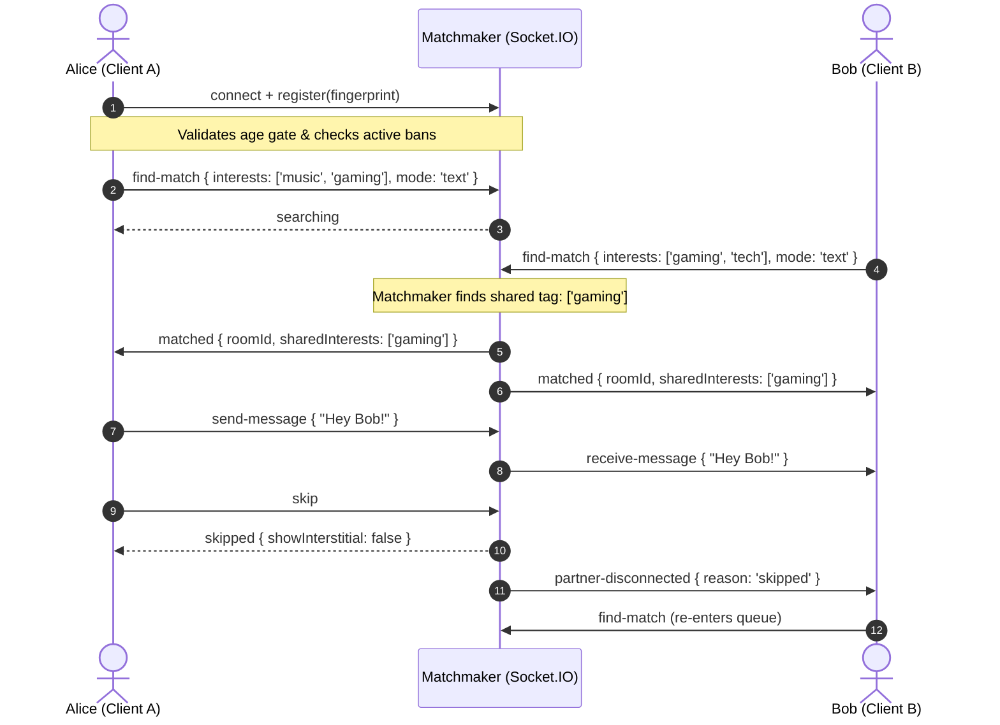

<<<<<<< HEAD
# 💬 Genz chitchat

> A next-generation, privacy-first anonymous stranger chat platform with real-time text, peer-to-peer WebRTC video, interest-based matchmaking, and secure email verification passes.

[](https://react.dev/)
[](https://www.typescriptlang.org/)
[](https://vitejs.dev/)
[](https://nodejs.org/)
[](https://socket.io/)
[](https://tailwindcss.com/)
[](LICENSE)
[](#roadmap)

---

## 📑 Table of Contents

- [Live Demo](#-demo)
- [About the Project](#-about-the-project)
- [Key Features](#-features)
- [Tech Stack](#-tech-stack)
- [How It Works](#-how-it-works)
- [Project Architecture](#-project-architecture)
- [Project Structure](#-project-structure)
- [Getting Started](#-getting-started)
  - [Prerequisites](#prerequisites)
  - [Step 1: Clone and Install](#1-clone-and-install)
  - [Step 2: Environment Configuration](#2-environment-configuration)
  - [Step 3: Run the Development Servers](#3-run-the-development-servers)
  - [Step 4: Matchmaking Test](#4-test-the-matchmaking)
  - [Docker Setup (Alternative)](#docker-container-setup)
- [Environment Variables Guide](#-environment-variables)
  - [Generating a Gmail App Password](#how-to-generate-a-gmail-app-password)
  - [Configuring Stripe & Razorpay Keys](#configuring-payment-provider-keys)
- [Available Scripts](#-available-scripts)
- [API & Socket.IO Reference](#-api--socket-reference)
  - [REST API Endpoints](#rest-api-endpoints)
  - [Socket.IO Events](#socketio-real-time-events)
- [Safety & Moderation](#-safety--moderation)
- [Deployment Guide](#-deployment)
- [Roadmap](#-roadmap)
- [Contributing](#-contributing)
- [License & Author](#-license--author)

---

## 🚀 Demo

- **Live URL:** [https://genz-chitchat-demo.example.com](https://genz-chitchat-demo.example.com) *(Replace with your live deployment link)*

### Screenshots & Preview

> Place your screenshots in [`docs/screenshots/`](docs/screenshots/) according to the [Screenshots Guide](docs/screenshots/README.md).

| Landing & Interest Tags | Real-time Chat Room |
| :---: | :---: |
|  |  |

| Email OTP Verification | Razorpay UPI Checkout |
| :---: | :---: |
|  |  |

---

## 💡 About the Project

**Genz chitchat** is an open-source, modern alternative to legacy anonymous chat platforms like Omegle and Chatroulette. Built for speed, safety, and responsiveness, it connects strangers across the globe in seconds without requiring intrusive registration or permanent account tracking.

### The Problem It Solves
Legacy stranger chat services suffered from dated user interfaces, frequent security vulnerabilities, bot spam, non-existent moderation, and poor mobile support. **Genz chitchat** fixes these fundamentals by providing:
1. **Real-time privacy:** Zero stored conversation logs — chats run entirely in memory.
2. **Intentional matching:** Strangers can pair based on shared topics and hashtags rather than pure randomness.
3. **Proactive protection:** Mandatory age consent gates, rate limiting, cryptographic device fingerprinting, and automated temporary bans for malicious actors.

### Who Is It For?
- **Users:** People wanting instant, spontaneous, interest-aligned conversations in a sleek, dark/light theme environment.
- **Engineers & Recruiters:** Developers looking for a clean, full-stack reference architecture implementing WebSockets, WebRTC signaling, cryptographic OTP verification, and modern React 19 state machines.

---

## ✨ Features

### 💬 Chat Experience
- **Real-time Text Messaging:** Lightning-fast bi-directional delivery powered by Socket.IO rooms.
- **Typing Indicators:** Real-time *"Stranger is typing..."* feedback with automatic timeouts.
- **Built-in Emoji Picker:** Native emoji selector drawer integrated into the chat input.
- **Instant Skip / Next:** One-click disconnect with automatic queuing into the next available stranger.
- **Disconnection Alerts:** Graceful notifications when a partner skips or leaves the session.

### 📹 Video Chat (WebRTC)
- **Peer-to-Peer Streaming:** Direct browser-to-browser media exchange via native WebRTC `RTCPeerConnection`.
- **Signaling Server:** Socket.IO relay for SDP offers, SDP answers, and ICE candidate exchange.
- **Audio & Video Controls:** Instant mute microphone and toggle camera stream buttons.
- **Fallback Handling:** Graceful UI fallback if a user doesn't have an accessible webcam.

### 🎯 Matchmaking Algorithm
- **Interest-Based Pairing:** Ranks queue candidates by shared lowercase tags (e.g., `#gaming`, `#music`, `#coding`).
- **Dynamic Fallback:** Automatically matches with any available stranger if no exact interest match is waiting.
- **Gender & Filter Preferences:** Allows users to filter by gender using passes.
- **Queue Transparency:** Live real-time user counter broadcasted every 5 seconds.

### 🛡️ Safety & Moderation
- **18+ Age Gate:** Compulsory modal ensuring users verify legal age before entering the queue.
- **Client Fingerprinting:** Unique hash generated per browser (`fingerprint.ts`) to enforce ban persistence across socket reconnects.
- **Profanity Sanitization:** Automatic filtering and masking of abusive language using bad-words regex dictionaries.
- **Community Reporting:** In-chat report system with selectable reasons (Harassment, Inappropriate, Spam).
- **Automated Temp-Bans:** Fingerprints receiving 5+ reports are automatically locked out for 24 hours.
- **Rate Limiting:** Protects against spam flood (max 10 messages per 10-second sliding window per socket).

### 🔐 Email Verification & OTP Engine
- **Cryptographic 6-Digit OTP:** Generated with secure `crypto.randomInt` (never `Math.random`).
- **Salted Hash Storage:** OTPs are never stored in plain text; stored using HMAC-SHA256 with unique 16-byte salts.
- **Strict Lifecycles:** 5-minute expiry countdown with immediate single-use invalidation upon verification.
- **Brute-Force Guard:** Maximum 5 failed verification attempts before the session is permanently locked.
- **Anti-Spam Rate Limits:** Max 3 OTP dispatches per 15 minutes per email, backed by a 60-second resend cooldown.
- **Segmented 6-Box UX:** Auto-focus advancement, backspace retraction, clipboard paste support, and spam folder guidance.
- **Nodemailer Transport:** Pre-configured for Gmail SMTP (App Password) with swappable support for Resend, Brevo, and SendGrid.

### 💳 Premium & Monetization
- **Razorpay Checkout Modal:** Clean UI mimicking native Razorpay checkout sheets.
- **Pass Options:** 1 Hour (₹199), 3 Hours (₹299), and 1 Day (₹399) passes.
- **Payment Method Selectors:** Branded cards for Google Pay, PhonePe, Paytm, and BHIM UPI QR.
- **Receipt Dispatch:** Simulated confirmation email dispatch upon successful checkout.
- **AdSense Ready:** Clean responsive banner and interstitial ad placeholders (`AdSlots.tsx`).

### 🎨 UI & Aesthetics
- **Modern Responsive Design:** Crafted with Tailwind CSS, supporting mobile, tablet, and desktop viewports.
- **Theme Switcher:** Seamless toggle between Modern Dark mode and Old Money Cream aesthetics.
- **Smooth Micro-Interactions:** Physics-based modal and transition animations via Framer Motion.
- **Cookie Consent Banner:** Compliant privacy preference banner for local storage usage.

---

## 🛠️ Tech Stack

| Layer | Technology | Purpose |
| :--- | :--- | :--- |
| **Frontend Framework** | React 19 | Declarative user interface with latest concurrent features |
| **Build Tool** | Vite 8 + TSX | Fast HMR dev server and optimized production bundler |
| **Language** | TypeScript 5 | End-to-end static typing and interface contracts |
| **Styling** | Tailwind CSS 4 | Utility-first responsive design and custom color tokens |
| **Animations** | Framer Motion 14 | Modal transitions, fade-ins, and button micro-interactions |
| **State Management** | Zustand 5 | Lightweight centralized store for chat, UI, and socket state |
| **Routing** | React Router 7 | Client-side page navigation (Landing, Chat, Privacy, Terms) |
| **Real-time Engine** | Socket.IO 4.8 | Bidirectional WebSocket connection and room management |
| **Video Protocol** | WebRTC | Direct peer-to-peer audio/video streaming via Google STUN |
| **Backend Server** | Node.js 18+ & Express 5 | High-throughput HTTP API and WebSocket signaling server |
| **Email Delivery** | Nodemailer 10 | SMTP & API email dispatcher with responsive HTML templates |
| **Security & Headers** | Helmet 8 & CORS | HTTP security headers and configurable CORS origins |
| **Rate Limiting** | express-rate-limit | HTTP brute-force and DDoS mitigation |
| **Containerization** | Docker & Compose | Multi-stage Dockerfiles and container orchestration |

---

## 🔄 How It Works

### Matching & Session Lifecycle



1. **Connection & Fingerprint:** The client generates a device fingerprint and establishes a WebSocket connection.
2. **Queueing:** The user selects interests and clicks **Start Chatting**. The client emits `find-match`.
3. **Smart Pairing:** The matchmaker first scans the queue for users sharing common interest tags. If none exist within a short threshold, it pairs with the longest-waiting stranger.
4. **Room Allocation:** Both clients join a unique Socket.IO room (`room_<id>`). If video mode is active, the designated initiator starts WebRTC peer connection signaling.
5. **Messaging:** Messages are sanitized for profanity, checked against rate limits, and relayed directly to the partner.
6. **Skip / Next:** When either user skips, the room is dismantled, the partner is notified, and both users can immediately re-enter the queue.

---

## 📂 Project Structure

```
Chatting website/
├── client/                          # React + TypeScript Frontend
│   ├── public/                      # Static assets, robots.txt, sitemap
│   ├── src/
│   │   ├── assets/                  # Images and static media
│   │   ├── components/
│   │   │   ├── ads/                 # AdSense slots and interstitial overlays
│   │   │   ├── chat/                # ChatInput, MessageBubble, TypingIndicator
│   │   │   ├── modals/              # GenderModal, PremiumModal, RazorpayModal
│   │   │   ├── moderation/          # ReportModal, SafetyBanner
│   │   │   ├── ui/                  # AgeGate, CookieConsent, ThemeToggle
│   │   │   └── video/               # WebRTC VideoChat interface
│   │   ├── hooks/                   # useSocket, useTheme custom hooks
│   │   ├── lib/                     # socket.ts client, fingerprint.ts
│   │   ├── pages/                   # Landing, Chat, Privacy, Terms, Safety
│   │   ├── store/                   # chatStore.ts, uiStore.ts (Zustand)
│   │   ├── App.tsx                  # Root routes and modal providers
│   │   ├── index.css                # Tailwind CSS v4 design tokens
│   │   └── main.tsx                 # DOM entry point
│   ├── package.json                 # Client dependencies and build scripts
│   └── vite.config.ts               # Vite configuration and plugins
│
├── server/                          # Express + Socket.IO Backend
│   ├── src/
│   │   ├── config/                  # env.ts (validated environment settings)
│   │   ├── routes/                  # health.ts, reports.ts, payment.ts
│   │   ├── scripts/                 # testEmail.ts (CLI diagnostic tool)
│   │   ├── services/
│   │   │   ├── email.ts             # Nodemailer transporter & HTML templates
│   │   │   ├── matchmaker.ts        # In-memory matchmaking queue engine
│   │   │   ├── moderation.ts        # Bad-words filter, reports, bans
│   │   │   └── otp.ts               # 6-digit cryptographic OTP hasher & limiter
│   │   ├── socket/                  # index.ts (Socket.IO event listeners)
│   │   └── index.ts                 # Server entry point & startup checks
│   ├── package.json                 # Server dependencies and scripts
│   └── tsconfig.json                # TypeScript compiler configuration
│
├── docs/
│   └── screenshots/                 # Screenshots & GIF assets for README
│       └── README.md                # Guide on required screenshots
│
├── .env.example                     # Full environment variables template
├── Dockerfile.client                # Multi-stage Nginx container build
├── Dockerfile.server                # Multi-stage Node.js container build
├── docker-compose.yml               # Local orchestration for client and server
└── README.md                        # Project documentation
```

---

## 🏁 Getting Started

### Prerequisites

Make sure the following tools are installed on your machine:
- **Node.js:** `v18.0.0` or higher ([Download Node.js](https://nodejs.org/))
- **npm:** `v9.0.0` or higher (bundled with Node)
- **Git:** ([Download Git](https://git-scm.com/))
- **Docker & Docker Compose:** *(Optional, only if using containers)*

---

### 1. Clone and Install

Clone the repository and install dependencies for both the `server` and `client`:

```bash
# 1. Clone the repository
git clone https://github.com/your-username/genz-chitchat.git
cd genz-chitchat

# 2. Install server dependencies
cd server
npm install

# 3. Install client dependencies
cd ../client
npm install

# 4. Return to root
cd ..
```

---

### 2. Environment Configuration

Create a `.env` file in the `server` directory:

```bash
# Copy the root template into server/.env
cp .env.example server/.env
```

Open `server/.env` and review the values. By default, the app is pre-configured to run immediately in local development mode.

> **Note on Email Sending:** In local development, if you haven't added your Gmail App Password yet, the server will log a diagnostic warning and provide a **Dev OTP** directly in the modal so you can test the full verification UI without waiting for SMTP setup!

---

### 3. Run the Development Servers

Open **two terminal windows**:

#### Terminal 1 — Backend Server
```bash
cd server
npm run dev
```
*The server will start on [http://localhost:3001](http://localhost:3001).*

#### Terminal 2 — Frontend Client
```bash
cd client
npm run dev
```
*The client will start on [http://localhost:5173](http://localhost:5173).*

Open your browser and navigate to **[http://localhost:5173](http://localhost:5173)**.

---

### 4. Test the Matchmaking

To test the real-time chat in 30 seconds:
1. Open **two separate browser windows** (or one normal tab and one Incognito tab) at `http://localhost:5173`.
2. Confirm the 18+ Age Gate on both tabs.
3. Click **Start Chatting — It's Free** on both tabs.
4. Both windows will instantly match together into a private room! Type a message in one tab and watch it appear live in the other.

---

### Docker Container Setup

You can also run both the client and server with a single command using Docker:

```bash
# Build and run client and server containers
docker-compose up --build
```

- **Client:** [http://localhost:3000](http://localhost:3000)
- **Server:** [http://localhost:3001](http://localhost:3001)

To stop the containers:
```bash
docker-compose down
```

---

## 🔑 Environment Variables

The table below lists all variables supported by `server/.env`. A complete template is available in [`.env.example`](.env.example).

| Variable | Required? | Default | Description | Example (Fake Value) |
| :--- | :---: | :---: | :--- | :--- |
| `PORT` | No | `3001` | HTTP and WebSocket port | `3001` |
| `NODE_ENV` | No | `development` | Runtime environment (`development` / `production`) | `development` |
| `CORS_ORIGIN` | Yes | `http://localhost:5173` | Allowed frontend origin for CORS and WebSockets | `http://localhost:5173` |
| `RATE_LIMIT_WINDOW_MS` | No | `60000` | General API rate limiting sliding window (in ms) | `60000` |
| `RATE_LIMIT_MAX` | No | `100` | Max HTTP requests per window per IP | `100` |
| `CHAT_RATE_LIMIT_WINDOW_MS` | No | `10000` | Chat spam prevention window (in ms) | `10000` |
| `CHAT_RATE_LIMIT_MAX` | No | `10` | Max chat messages allowed per socket per window | `10` |
| `REPORTS_BEFORE_BAN` | No | `5` | Report count threshold triggering automated ban | `5` |
| `BAN_DURATION_HOURS` | No | `24` | Duration of temporary ban lockouts (in hours) | `24` |
| `AD_INTERSTITIAL_SKIP_COUNT` | No | `3` | How many skips before showing an interstitial ad | `3` |
| `EMAIL_PROVIDER` | No | `gmail` | Email provider (`gmail`, `smtp`, `resend`, `brevo`, `sendgrid`) | `gmail` |
| `SMTP_HOST` | If SMTP | `smtp.gmail.com` | SMTP outgoing mail server hostname | `smtp.gmail.com` |
| `SMTP_PORT` | If SMTP | `465` | SMTP port (`465` for SSL, `587` for STARTTLS) | `465` |
| `SMTP_SECURE` | If SMTP | `true` | Use TLS/SSL secure socket connection | `true` |
| `SMTP_USER` | Yes (for email) | `""` | Outgoing email address or SMTP username | `alex.dev@gmail.com` |
| `SMTP_PASS` | Yes (for email) | `""` | 16-character Google App Password (not your normal password) | `abcd efgh ijkl mnop` |
| `EMAIL_FROM` | No | `Genz chitchat <noreply@...>` | Sender display name and email address header | `"Genz chitchat <noreply@example.com>"` |
| `RESEND_API_KEY` | Optional | `""` | API key if using Resend email provider | `re_123456789abcdef` |
| `BREVO_API_KEY` | Optional | `""` | API key if using Brevo (Sendinblue) email provider | `xkeysib-123456789abcdef` |
| `SENDGRID_API_KEY` | Optional | `""` | API key if using SendGrid provider | `SG.123456789abcdef` |

---

### How to Generate a Gmail App Password

To deliver OTP emails directly into user inboxes using Gmail SMTP:

1. Go to your **[Google Account Security Settings](https://myaccount.google.com/security)**.
2. Ensure **2-Step Verification** is turned **ON**.
3. In the search bar at the top of your Google Account, search for **"App passwords"** (or scroll to *How you sign in to Google* → *2-Step Verification* → *App passwords*).
4. Enter an app name, e.g., `Genz Chitchat Server`, and click **Create**.
5. Google will generate a **16-character passcode** (e.g., `abcd efgh ijkl mnop`).
6. Copy that 16-character code into `server/.env`:
   ```env
   EMAIL_PROVIDER=gmail
   SMTP_HOST=smtp.gmail.com
   SMTP_PORT=465
   SMTP_SECURE=true
   SMTP_USER=your-actual-email@gmail.com
   SMTP_PASS=abcdefghijklmnop
   EMAIL_FROM=Genz chitchat <noreply@genzchitchat.com>
   ```
7. Verify the setup with the automated test tool:
   ```bash
   cd server
   npm run test:email -- your-personal-email@gmail.com
   ```

---

### Configuring Payment Provider Keys

#### Stripe Test Keys (Phase 3+)
1. Register for a free developer account at **[stripe.com](https://stripe.com)**.
2. In the top navigation, toggle **Test Mode**.
3. Go to **Developers** → **API Keys** and copy:
   - Publishable key (`pk_test_...`)
   - Secret key (`sk_test_...`)
4. Add to `.env`:
   ```env
   STRIPE_SECRET_KEY=sk_test_51AbcDef...
   ```

#### Razorpay Test Keys
1. Create a free sandbox account at **[razorpay.com](https://razorpay.com)**.
2. Navigate to **Settings** → **API Keys** → **Generate Test Key**.
3. Copy your `rzp_test_...` key ID and key secret.

---

## 📜 Available Scripts

### Server Scripts (`server/package.json`)

| Command | Action |
| :--- | :--- |
| `npm run dev` | Runs server with hot reload using `tsx watch src/index.ts` |
| `npm run build` | Compiles TypeScript into JavaScript (`dist/`) via `tsc` |
| `npm run start` | Runs the compiled production server (`node dist/index.js`) |
| `npm run seed` | Seeds database or initial system configurations |
| `npm run test:email -- <email>` | CLI diagnostic tool to verify SMTP connection and deliver a test email |

### Client Scripts (`client/package.json`)

| Command | Action |
| :--- | :--- |
| `npm run dev` | Starts Vite local development server on `http://localhost:5173` |
| `npm run build` | Runs typecheck (`tsc -b`) and builds production bundle in `dist/` |
| `npm run preview` | Locally serves the production build bundle for verification |
| `npm run lint` | Runs the ultra-fast Oxlint linter across client code |

---

## 🔌 API & Socket Reference

### REST API Endpoints

| Method | Endpoint | Description | Request Body | Response Payload |
| :--- | :--- | :--- | :--- | :--- |
| `GET` | `/api/health` | Health check & metrics | *None* | `{ status, uptime, online, queueSize }` |
| `POST` | `/api/payment/send-otp` | Generates & sends 6-digit OTP | `{ email, mobile? }` | `{ success, message, expiresInSeconds, cooldownSeconds }` |
| `POST` | `/api/payment/verify-otp` | Validates submitted 6-digit OTP | `{ email, otp }` | `{ success, verified, message }` |
| `GET` | `/api/payment/email-status` | Status of configured mail service | *None* | `{ configured, provider, host, port }` |
| `POST` | `/api/payment/receipt` | Simulates payment receipt email | `{ email, plan, price, paymentId }` | `{ success, message }` |
| `POST` | `/api/reports` | Submit community report | `{ reportedFingerprint, reporterFingerprint, reason }` | `{ success, banned }` |
| `GET` | `/api/admin/reports` | Retrieve list of reports | *None* | `{ reports: [...], total }` |
| `POST` | `/api/admin/unban` | Manually lift a user ban | `{ fingerprint }` | `{ success }` |

---

### Socket.IO Real-time Events

#### Client to Server (Emitters)

| Event Name | Payload | Description |
| :--- | :--- | :--- |
| `register` | `{ fingerprint: string }` | Registers client device fingerprint and checks active bans |
| `find-match` | `{ interests: string[], mode: 'text'\|'video', filterGender? }` | Enters matchmaking queue with topic preferences |
| `send-message` | `{ message: string }` | Dispatches message to partner; rate-limited and sanitized |
| `typing` | `{ isTyping: boolean }` | Broadcasts real-time typing indicator to active partner |
| `skip` | *None* | Disconnects current partner and requests next match |
| `report` | `{ reason: string }` | Reports stranger for misconduct and triggers auto-skip |
| `webrtc-offer` | `{ offer: RTCSessionDescriptionInit }` | Relays WebRTC offer to peer |
| `webrtc-answer` | `{ answer: RTCSessionDescriptionInit }` | Relays WebRTC answer to peer |
| `webrtc-ice-candidate` | `{ candidate: RTCIceCandidateInit }` | Relays WebRTC network traversal candidates |
| `webrtc-media-state` | `{ videoEnabled: boolean, audioEnabled: boolean }` | Synchronizes mute/camera state with peer |

#### Server to Client (Listeners)

| Event Name | Payload | Description |
| :--- | :--- | :--- |
| `online-count` | `number` | Broadcasts live total connected user count (every 5s) |
| `searching` | *None* | Notifies client that they are actively waiting in queue |
| `matched` | `{ roomId, sharedInterests, mode, isInitiator, partnerGender? }` | Notifies client that a match was successfully established |
| `receive-message` | `{ message: string, timestamp: number, flagged: boolean }` | Delivers partner's message to client |
| `partner-typing` | `{ isTyping: boolean }` | Informs client whether partner is typing |
| `partner-disconnected` | `{ reason: 'skipped' \| 'disconnected' \| 'reported' }` | Informs client that partner has exited the room |
| `skipped` | `{ showInterstitial: boolean }` | Confirms skip and signals if interstitial ad is due |
| `rate-limited` | `{ message: string }` | Warning emitted when sending messages too quickly |
| `banned` | `{ message: string }` | Emitted when a client's device fingerprint is banned |
| `report-submitted` | `{ message: string }` | Confirmation that user report was registered |

---

## 🛡️ Safety & Moderation

Safety is a core priority of **Genz chitchat**. The platform utilizes a multi-layered moderation pipeline:

1. **Mandatory 18+ Age Gate:** An explicit age confirmation modal blocks access until legal adulthood is acknowledged.
2. **Device Fingerprinting:** The browser builds a deterministic hardware/canvas fingerprint (`fingerprint.ts`). If a malicious user refreshes or changes socket connections, their ban remains active.
3. **Automated Profanity & Spam Filter:** All chat messages pass through `bad-words` sanitization on the server. Toxic words are sanitized into asterisks before reaching the recipient.
4. **Automated 24-Hour Banning:** If a user receives **5 reports** (`REPORTS_BEFORE_BAN=5`) from different strangers, their fingerprint is automatically banned for 24 hours. Banned sockets are immediately disconnected upon reconnection.
5. **Anti-Flood Rate Limiting:** Socket messages are capped at 10 messages per 10 seconds. Flooding results in temporary socket message silencing.
6. **Responsible Use Policy:** Conversations are strictly ephemeral and anonymous. No chat logs are stored on disk or in databases. Users are reminded never to share financial information, passwords, or personal identity details.

---

## 🚢 Deployment

### Deploying the Frontend (Client)

The frontend is a static single-page app and can be deployed in minutes on any static host:

#### Option A: Vercel / Netlify
1. Connect your GitHub repository.
2. Set **Root Directory** to `client`.
3. Set **Build Command** to `npm run build`.
4. Set **Output Directory** to `dist`.
5. Add an environment variable:
   ```env
   VITE_SERVER_URL=https://your-server-domain.com
   ```

#### Option B: Docker + Nginx
The repository includes a production-ready `Dockerfile.client` that compiles the React app and serves it using an alpine Nginx container:
```bash
docker build -f Dockerfile.client -t genz-chitchat-client .
docker run -p 80:80 genz-chitchat-client
```

---

### Deploying the Backend (Server)

The backend requires a persistent Node.js runtime that supports WebSockets.

#### Option A: Railway / Render / Fly.io
1. Create a new service and point to the repository.
2. Set **Root Directory** to `server`.
3. Set **Build Command** to `npm run build`.
4. Set **Start Command** to `npm run start`.
5. Configure environment variables in the dashboard:
   - `PORT=3001` (or provider's `$PORT`)
   - `NODE_ENV=production`
   - `CORS_ORIGIN=https://your-frontend-domain.com`
   - `SMTP_USER=...`
   - `SMTP_PASS=...`

#### Option B: Ubuntu VPS with Nginx Reverse Proxy
When running behind an Nginx reverse proxy, ensure WebSocket upgrade headers are passed:
```nginx
location /socket.io/ {
    proxy_pass http://localhost:3001/socket.io/;
    proxy_http_version 1.1;
    proxy_set_header Upgrade $http_upgrade;
    proxy_set_header Connection "Upgrade";
    proxy_set_header Host $host;
}

location /api/ {
    proxy_pass http://localhost:3001/api/;
    proxy_set_header Host $host;
}
```

---

## 🗺️ Roadmap

The current version includes a complete, working real-time chat, video signaling, moderation, and secure OTP engine. Planned future enhancements include:

- [ ] **Persistent PostgreSQL Storage:** Schema migrations via Prisma/Drizzle for historical audit logs and user accounts.
- [ ] **Redis Matchmaking Queue:** Moving in-memory queues to Redis sorted sets to scale across multiple server instances.
- [ ] **TURN Server Cluster:** Co-turn server deployment to bypass restrictive symmetric NATs and mobile carrier firewalls.
- [ ] **AI-Powered Webcam Moderation:** Client-side TensorFlow.js NSFW detection to automatically blur inappropriate video frames.
- [ ] **Production Webhooks:** Automatic Stripe & Razorpay webhook listeners to auto-grant persistent VIP tokens.
- [ ] **Audio Clips / Voice Notes:** Quick microphone recording and short voice snippet delivery.
- [ ] **Mobile Native Apps:** iOS and Android clients built with React Native / Expo.

---

## 🤝 Contributing

Contributions are warmly welcome! To contribute:

1. **Fork** the repository on GitHub.
2. **Clone** your fork locally:
   ```bash
   git clone https://github.com/your-username/genz-chitchat.git
   ```
3. Create a descriptive feature branch:
   ```bash
   git checkout -b feature/amazing-new-feature
   ```
4. Commit your changes with clear, structured messages:
   ```bash
   git commit -m "feat(matching): add geographic region preference filter"
   ```
5. Push to your branch:
   ```bash
   git push origin feature/amazing-new-feature
   ```
6. Open a **Pull Request** detailing what changes were made and why.

---

## 📄 License & Author

This project is licensed under the **MIT License** — see the [LICENSE](LICENSE) file for details.

### Author
- **GitHub:** [@your-username](https://github.com/your-username) *(Replace with your GitHub profile link)*
- **Project Repository:** [https://github.com/your-username/genz-chitchat](https://github.com/your-username/genz-chitchat)

---

*Made with passion for privacy, connection, and clean code.*
=======
# Genz-Chitchat-
Real-time anonymous stranger chat web app built with React, Node.js and Socket.IO. Random matching, email OTP verification, moderation tools, and premium subscriptions
>>>>>>> 11a33e15408e996b92009a90b4cf209f959981ee
